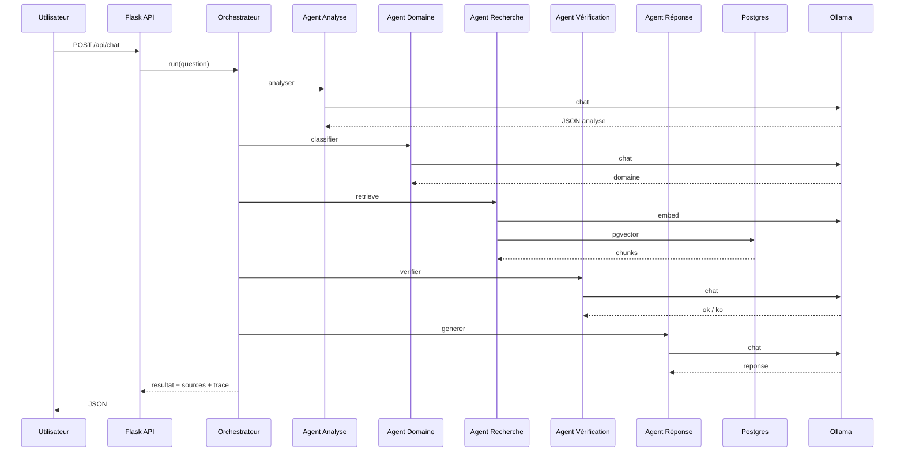

# Architecture agents juridiques

Ce document décrit le **graphe d'agents** visé par Nyateƒe, l'état du **MVP** et la feuille de route d'implémentation côté backend Flask.

## Vision produit

Nyateƒe ne s'appuie pas sur la seule mémoire paramétrique d'un LLM. Le parcours cible :

```text
Question utilisateur
        |
        v
   [1 Analyse]  ---- reformulation, intention, niveau de risque
        |
        v
   [2 Domaine]  ---- civil, pénal, travail, commercial, etc.
        |
        v
   [3 Recherche] ---- pgvector + filtres (type, date, doc_type)
        |
        v
   [4 Vérification] -- cohérence extrait / question, couverture
        |
        v
   [5 Réponse]  ---- génération sourcée + avertissement juridique
        |
        v
   Réponse + sources (+ orientation avocat si besoin)
```

Chaque étape peut être un **agent** (prompt + contraintes + sortie structurée JSON) orchestré par un **coordinateur** dans le backend.

## Graphe full (production)

Avec `AGENT_GRAPH_ENABLED=true` et `AGENT_GRAPH_MODE=full` :

| Etape | Composant | LLM |
|-------|-----------|-----|
| Analyste | `nodes/analyste.py` | Oui |
| Routeur | `nodes/routeur.py` | Oui (specialistes disponibles uniquement) |
| Specialiste | `nodes/specialiste.py` | Non (pgvector par domaine, sans fallback global) |
| Indisponible | `nodes/specialiste_indisponible.py` | Non |
| Synthese | `nodes/redacteur.py` | Oui |
| Verificateur | `nodes/verificateur.py` | Oui |
| Garde-fou | `nodes/garde_fou.py` | Non |

Registre : `domains.yaml` + `specialist_registry.py` (chunks indexes par `metadata.domaine`).

Variables : `AGENT_MAX_SOURCES=3`, `RAG_TOP_K=3`.

Corpus v1 : penal, famille (2 versions), travail, affaires (CGI-OTR), constitution, donnees_personnelles. Ingestion : `backend/scripts/ingest_corpus_v1.sh`.

## Phase 2 : agents par document

Pipeline partage : [`backend/app/services/retrieval_pipeline.py`](../backend/app/services/retrieval_pipeline.py)

| Mode (`AGENT_RETRIEVAL_MODE`) | Comportement |
|-------------------------------|--------------|
| `domain` | Recherches paralleles par domaine (`domains.yaml`) |
| `document` | Catalogue DB + candidats vectoriels + recherches par `document_id` |
| `hybrid` | Fusion domaine + document, deduplication par chunk |

Fichiers cles :

- [`document_router.py`](../backend/app/agents/document_router.py) : ciblage de documents
- [`document_catalog.py`](../backend/app/agents/document_catalog.py) : cache catalogue
- [`parallel_retrieval.py`](../backend/app/agents/parallel_retrieval.py) : agents document en parallele

Backfill metadata chunks : `python backend/scripts/backfill_chunk_metadata.py` (depuis la racine du dépôt, avec le venv backend actif).

## Phase 2 : streaming UI (SSE)

Route : `POST /api/chat/stream` (requiert `AGENT_GRAPH_ENABLED=true`).

Événements JSON (`data: {...}`) :

- `phase` : `retrieval` ou `generation`
- `meta` : mode, domaines, documents cibles
- `sources` : extraits officiels
- `token` : fragment de reponse
- `done` : reponse complete + sources
- `error` : message utilisateur

Frontend : [`sendChatStream`](../frontend/src/lib/api.ts) avec repli sur `POST /api/chat`.

Desactiver le stream cote UI : `VITE_CHAT_STREAM=false`.

## Etat actuel

| Agent | Fichier | Role |
|-------|---------|------|
| Analyste | `nodes/analyste.py` | Reformulation, clarification |
| Routeur | `nodes/routeur.py` | Dispatch vers un specialiste couvert |
| Specialiste | `nodes/specialiste.py` | Retrieval strict par domaine |
| Specialiste indisponible | `nodes/specialiste_indisponible.py` | Message chaleureux, `sources: []` |
| Synthese | `nodes/redacteur.py` | Reponse citoyenne (max 3 sources API) |
| Verificateur | `nodes/verificateur.py` | Controle, boucle max 2 essais |
| Garde-fou | `nodes/garde_fou.py` | Disclaimer si reponse sourcee |
| Repli | `nodes/repli.py` | Echec sans sources |

`POST /api/chat` : salutations via `chat_intent.py` ; juridique via graphe si `AGENT_GRAPH_ENABLED=true`.

Reponse API etendue : `mode` (`legal`, `clarification`, `fallback`, `small_talk`) et `trace` (logs serveur).

```text
Graphe (AGENT_GRAPH_ENABLED=true)

  question --> Analyste --> Routeur --> Chercheurs --> Redacteur --> Verificateur
                |                                              | retry (x2 max)
                v                                              v
            Clarify                                         Repli / Garde-fou
```

## Architecture cible (backend)

Proposition de modules (à créer progressivement) :

```text
backend/app/agents/
├── orchestrator.py      # Enchaîne les étapes, contexte partagé
├── schemas.py           # TypedDict / dataclasses par étape
├── analyse_agent.py
├── domaine_agent.py
├── recherche_agent.py   # wrapper RAG + filtres domaine
├── verification_agent.py
└── reponse_agent.py
```

### Contexte partagé (exemple)

```python
# Conceptuel - non implémenté intégralement au MVP
{
  "question_originale": str,
  "question_normalisee": str,
  "domaine_juridique": str | None,
  "chunks": list[ChunkHit],
  "verification": {"ok": bool, "motifs": list[str]},
  "reponse_finale": str | None,
  "trace": list[dict]  # pour debug / UI future
}
```

### Contrats de sortie recommandés

Forcer du **JSON** en sortie des agents 1, 2 et 4 (parse + retry une fois) :

- **Analyse** : `{ "intention", "entites", "clarification_necessaire" }`
- **Domaine** : `{ "domaine", "confiance", "sous_domaine" }`
- **Vérification** : `{ "peut_repondre", "sources_utilisees", "avertissements" }`

L'agent **Réponse** produit le texte utilisateur + liste d'identifiants de chunks cités.

## Modèles et infra

| Rôle | Modèle MVP | Évolution |
|------|------------|-----------|
| Génération (tous agents LLM) | `mistral:7b-instruct-q4_K_M` | Même modèle, prompts différents |
| Embeddings | `nomic-embed-text` | Modèle multilingue FR si besoin |
| Fallback | API Mistral (option) | Pics de charge ou timeout |

Tous les appels Ollama passent par `OllamaRequestQueue` (un job lourd à la fois).

## Filtres recherche (agent 3 enrichi)

Quand l'agent **Domaine** sera actif :

```sql
-- Conceptuel
WHERE d.doc_type = ANY(%s) OR metadata->>'domaine' = %s
ORDER BY embedding <=> query_vector
LIMIT k
```

Indexation : enrichir `legal_documents.metadata` avec `{ "domaine": "travail" }` validé par l'équipe juridique.

## UX frontend (évolution)

| Fonctionnalité | MVP | Cible |
|----------------|-----|-------|
| Chat simple | Oui | Oui |
| Affichage sources | Oui | Oui + lien vers texte complet |
| Trace agents | Non | Panneau "Étapes" (Analyse, Domaine, etc.) |
| Clarification | Non | Question de suivi si agent Analyse le demande |

## Phases d'implémentation

### Phase A (court terme)

1. Extraire `recherche` + `reponse` dans `agents/recherche_agent.py` et `agents/reponse_agent.py`.
2. `orchestrator.run(question)` appelé depuis `chat.py` sans changer le contrat API.
3. Journaliser `trace` côté serveur (logs structurés).

### Phase B

1. Agent **Domaine** : classification + filtre pgvector.
2. Agent **Analyse** : reformulation ; refuser les questions hors périmètre togolais avec message clair.

### Phase C

1. Agent **Vérification** : second appel LLM "les extraits suffisent-ils ?".
2. Si non : réponse honnête + orientation professionnelle, sans hallucination.

### Phase D (produit)

1. Jurisprudence (nouvelles tables + pipeline d'indexation).
2. Langues Ewé / Kabiyè (TTS/STT + modèles locaux si disponibles).

## Diagramme séquence (cible)



## Références code MVP

| Fichier | Rôle |
|---------|------|
| `backend/app/services/rag_service.py` | Pipeline RAG actuel |
| `backend/app/services/ollama_client.py` | Client Ollama |
| `backend/app/services/ollama_queue.py` | Concurrence |
| `backend/migrations/001_init.sql` | Schéma documents / chunks |

## Critères de succès agents

- **Traçabilité** : chaque affirmation importante liée à un `chunk_id`.
- **Refus** : si pas de source au-dessus du seuil, message explicite.
- **Latence** : acceptable sur VM MVP (~1 min chat) ; file visible via `/api/queue`.
- **Conformité** : mention légale présente sur toute réponse grand public.
